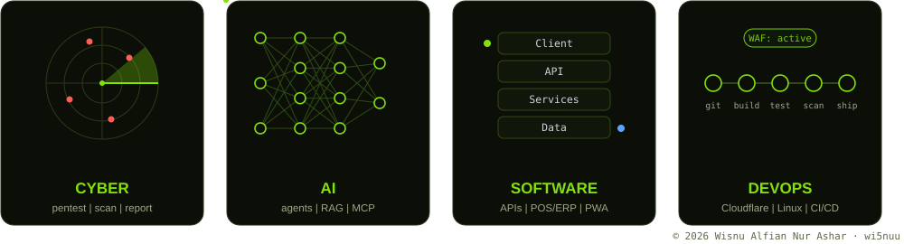
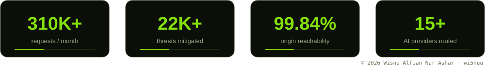
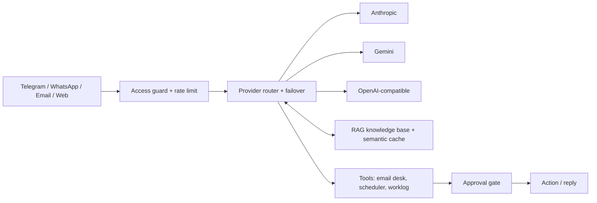
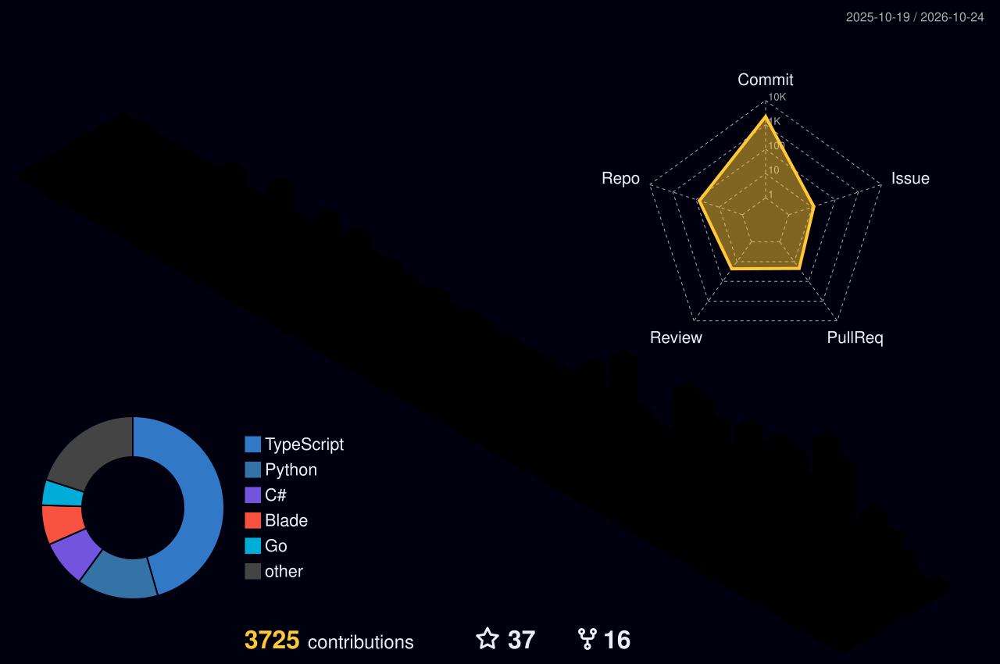
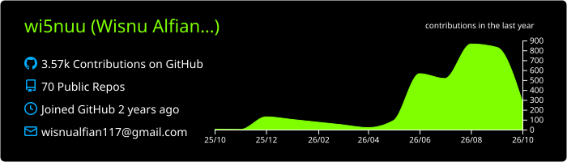
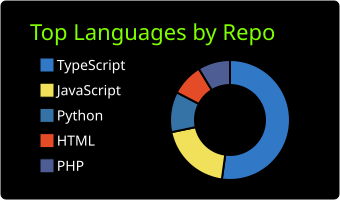
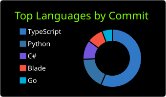
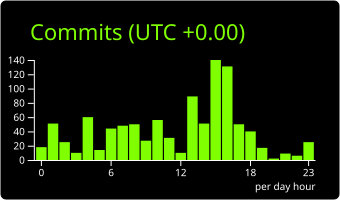

<!-- WISNU ALFIAN NUR ASHAR — GitHub profile README -->


<div align="center">


<br/>

[](https://www.wisnualfiannurashar.my.id)
[](https://www.wisnualfiannurashar.my.id/CV_Wisnu_Alfian_Nur_Ashar.pdf)
[](https://linkedin.com/in/wisnu-alfian-nur-ashar)
[](mailto:wisnualfiannurashar@gmail.com)

[](https://github.com/wi5nuu)
[](https://github.com/wi5nuu?tab=followers)
[](https://github.com/wi5nuu)
-84E10C?style=flat-square&labelColor=0A0A0A)

</div>


### `> cat about.json`

```json
{
  "name": "Wisnu Alfian Nur Ashar",
  "location": "Bekasi, West Java, Indonesia",
  "education": "B.IT, President University (GPA 3.54, 2024-2027)",
  "role": "Full-Stack Engineer",
  "now": [
    "Software Engineer Intern @ PT Grahabuana Cikarang (Jababeka)",
    "Full Stack Engineer @ Ashar Grosir Parfum (sole engineer)"
  ],
  "focus": ["Production systems", "AI agents", "Security testing"],
  "open_to": "Internship / junior roles, collaboration, security research"
}
```

I build and operate systems end to end: requirements, architecture, security, deployment, and the servers behind them. I explain the result clearly to non-technical teams, and I use AI tools such as Claude Code with human review of every output.

**Ask me about** `Laravel` · `Next.js` · `Go` · `PostgreSQL` · `AI agents & RAG` · `Cloudflare WAF` · `Pentest reporting`

> *"Any fool can write code that a computer can understand. Good programmers write code that humans can understand."* — Martin Fowler

<br clear="both"/>

<div align="center">

</div>


## Four realms I work in

<div align="center">

</div>

<details>
<summary><b>CYBER</b> — how I test and report</summary>
<br/>

1. **Scope & recon:** agree rules of engagement, map the attack surface.
2. **Scan & enumerate:** Kali Linux toolset and Burp Suite for services, endpoints and misconfigurations.
3. **Validate:** confirm each finding with a safe proof of concept and rate its real impact.
4. **Report:** severity, reproduction steps, evidence, remediation.
5. **Fix & retest:** RBAC, CSP, rate limiting, WAF rules, then verify the hole is closed.

</details>

<details>
<summary><b>AI</b> — agents in production, not demos</summary>
<br/>

Agents via API with tool-calling, a RAG knowledge base, multi-provider routing with failover, semantic caching, MCP, and approval gates before any action touches the real world.

</details>

<details>
<summary><b>SOFTWARE</b> — from requirement to release</summary>
<br/>

Domain modelling first, typed code (TypeScript, PHP 8, Go), PostgreSQL with row locking where money and stock are involved, automated tests, and documentation the next engineer can actually use.

</details>

<details>
<summary><b>DEVOPS</b> — I run what I ship</summary>
<br/>

Linux VPS (Nginx, PM2, Docker), GitHub Actions CI/CD, Cloudflare WAF / Bot Fight Mode / Turnstile, DNS and TLS 1.3, Google Cloud Console, uptime monitoring.

</details>


## Production numbers (last 30 days, Cloudflare)

<div align="center">

</div>


## Featured work

<details open>
<summary><b>Ashar Grosir Parfum — POS/ERP + e-commerce</b> <i>(Production, sole engineer)</i></summary>
<br/>

- **POS/ERP (Laravel 12, PostgreSQL):** millilitre-based stock ledger with row locking (no overselling), shifts, returns, wholesale notes, attendance with selfie + geofence, AI assistant with tool-calling.
- **Storefront (Next.js 16, Supabase):** PWA + Android APK for wholesale partners, AI chatbot, technical SEO and AI-search visibility.
- **Ops:** 310K+ requests/month at 99.84% origin reachability and 0.15% 5xx; Cloudflare WAF mitigates 22K+ malicious requests/month.
- **Quality:** Lighthouse 96+ / 94+ / 98+, 1.34 s average load, 91% "Good" LCP, ~70 automated tests, GitHub Actions CI/CD.
- Automated orders, stock sync and reporting for 100+ daily transactions, cutting reconciliation time **60%**.

`Laravel` `Next.js` `PostgreSQL` `Supabase` `Cloudflare` `Docker` `Nginx` `PM2`

</details>

<details>
<summary><b>Wanar AI — personal AI agent platform</b> <i>(Active)</i></summary>
<br/>

Self-hosted agent platform (~57,000 lines, 200+ commits).



- Routes **15+ AI providers** with automatic failover; RAG over source code; semantic caching.
- SSRF protection, approval-gated actions, token-guarded APIs, **47** automated test files.
- Command Center with live FX / economy / tech intel and a nightly self-review that feeds lessons back into prompts.

`Node.js` `React` `SQLite` `RAG` `MCP` `Playwright`

</details>

<details>
<summary><b>Internal tools @ Grahabuana (Jababeka)</b> <i>(Internship)</i></summary>
<br/>

- **Water Meter Management System:** mobile PWA with camera capture, OCR, maps and per-cluster dashboards, replacing paper logs and re-typing.
- **Industrial Visit booking platform:** Xendit invoicing + webhooks, automatic vouchers, WhatsApp/email notifications, 3 admin roles, audit trail.
- **PDF Toolkit:** 30 on-device document tools, 87 automated tests, Docker.

</details>

<details>
<summary><b>ColonyAI — automated plate-count reader</b> <i>(Production)</i></summary>
<br/>

YOLOv8 pipeline turning agar plate photos into CFU/ml lab reports: **94.1% mAP@0.5**, 94.7% precision, 92.5% recall over 56,124 annotated boxes; SHA-256 chained audit trail for ISO 17025.

`YOLOv8` `FastAPI` `Next.js` `PostgreSQL` `OpenCV`

</details>

<details>
<summary><b>SENTINEL-X — multi-domain threat intelligence</b> <i>(Proof of concept)</i></summary>
<br/>

Fusion platform correlating Aviation, Maritime, Cyber, Space, Seismic and RF/SIGINT signals with a real-time pipeline (Kafka + TimescaleDB).

`FastAPI` `React` `PyTorch` `Kafka` `TimescaleDB` `Docker`

</details>

<div align="center">

<a href="https://github.com/wi5nuu/wanar-ai"></a>
<a href="https://github.com/wi5nuu?tab=repositories"></a>

</div>


## Security

- **Responsible disclosure (2026):** reported an NVIDIA infra-controller flaw (BMC admin password exposed via an `ipmitool` argument); validated and fixed within **48 hours**.
- Penetration testing and vulnerability scanning with **Kali Linux** and **Burp Suite**, delivered as structured reports.
- OWASP Foundation member; open-source contributions to NASA and Microsoft projects.


## Toolbox

<div align="center">

<br/>


</div>


## Activity

<div align="center">












</div>

<div align="center">

<sub>☕ Like my work? <a href="https://ko-fi.com/wi5nuu">Ko-fi</a> · <a href="https://saweria.co/wi5nuu">Saweria</a></sub>


<sub>© 2026 Wisnu Alfian Nur Ashar · All rights reserved · Content and artwork may not be copied or modified without permission (see LICENSE)</sub>

</div>
